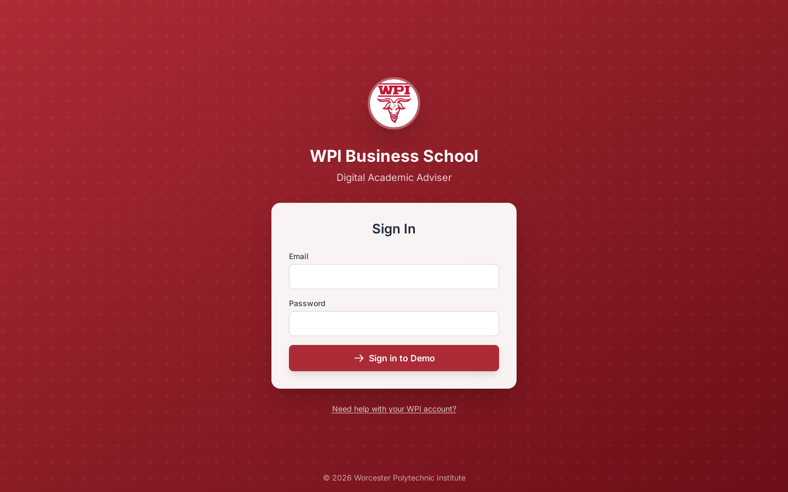
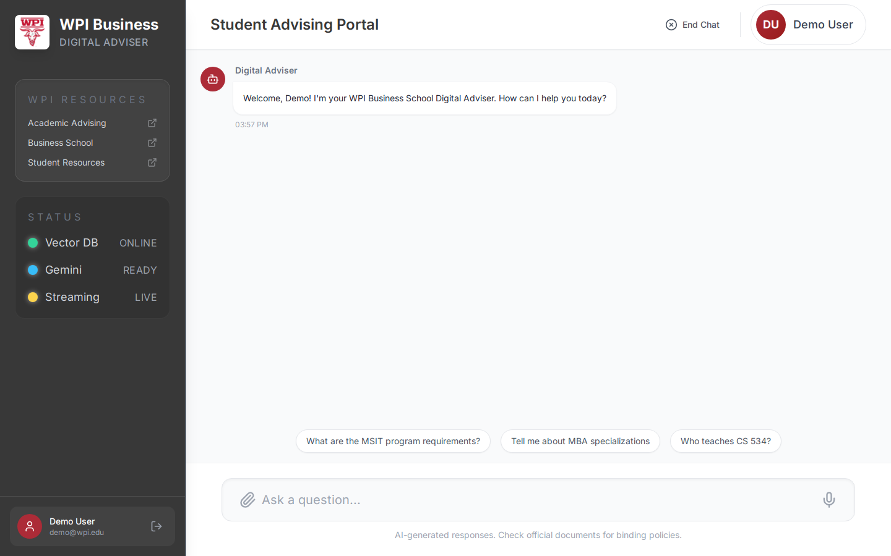
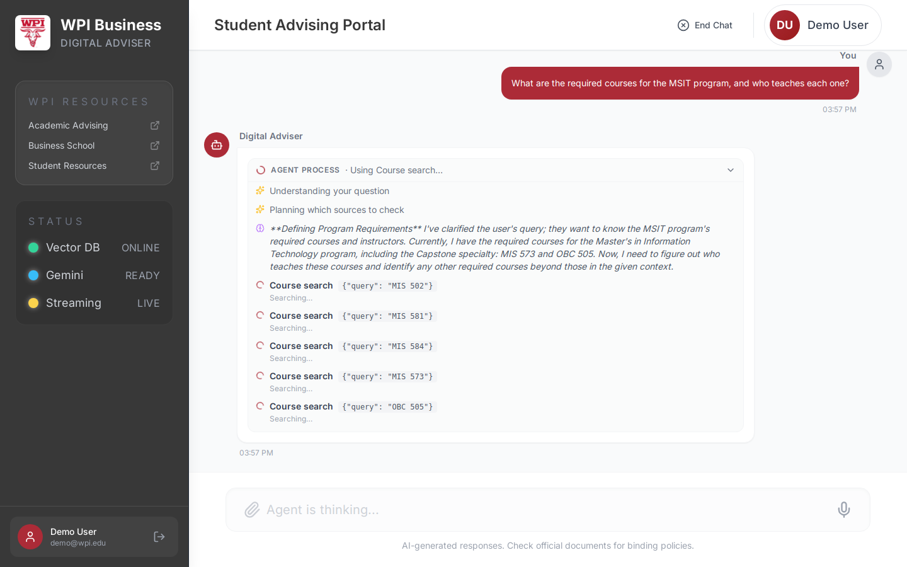
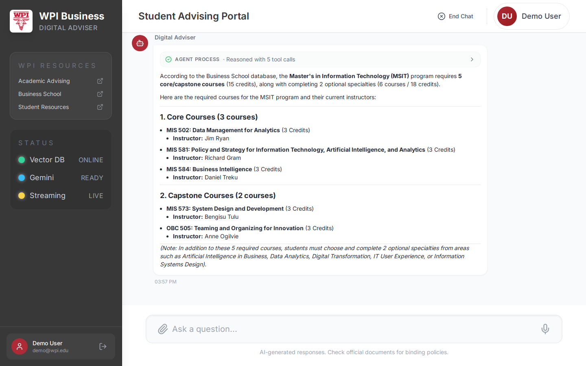
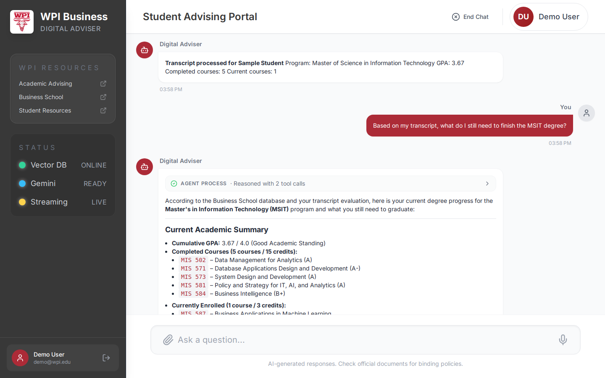
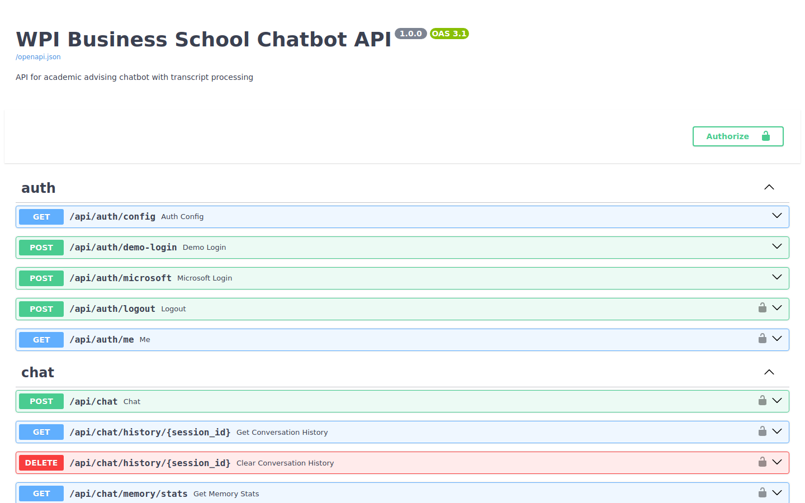

# WPI Business School Digital Adviser

Academic-advising chat for WPI Business School graduate students. A **LangGraph tool-calling agent**
answers from an authoritative SQLite database first and the PDF course catalogs second, reads an
uploaded transcript to audit degree progress, and streams its reasoning live. The stack is built to
run in production: HTTPS with a strict CSP, cookie-based auth with server-side revocation, per-user
rate limits, encrypted session state in Redis, offline-built vector indexes, and redacted tracing.

## Highlights

| Area | What it does |
|------|--------------|
| **Agent** | LangGraph `agent ⇄ tools` graph on Gemini 3.8 Flash with native, parallel tool calling and an 8-round tool budget |
| **Database-first retrieval** | SQLite is the source of truth; semantic search over the PDF catalogs fills gaps; query variations retry before giving up |
| **Live process view** | Gemini thought summaries, every tool call and its result, then the answer, streamed over SSE |
| **Transcript audit** | Gemini reads the PDF; validated fields drive `degree_progress` against program requirements |
| **Security** | HTTPS + HSTS, CSP without `unsafe-inline`, HttpOnly cookie sessions, CSRF header, token revocation, session ownership, prompt-injection fencing |
| **Reliability** | Per-call timeouts and backoff retries, intent classifier fails open, 120 s turn deadline, agent cancelled on disconnect |
| **Operations** | Stateless workers (state in Redis), versioned vector indexes with atomic switch and rollback, Let's Encrypt with auto-renewal, LangSmith traces with PII redaction |
| **MCP server + Agent Skills** | The same retrieval layer, published to Claude Code / Cursor / Dify, with self-checking audit and planning skills |

## Screenshots

| Sign in (demo account) | Chat home with live system status |
|---|---|
|  |  |

| Live agent process: thoughts + parallel tool calls | Streamed answer, process collapsed when done |
|---|---|
|  |  |

| Transcript uploaded, then a personal degree audit | API documentation (Swagger UI) |
|---|---|
|  |  |

The transcript in these screenshots is the synthetic fixture in `e2e/fixtures/`. All six are
regenerated from a running stack with `npm run screenshots` (see [Testing](#testing)).

## Architecture

The design reference, with the state model, threat model, failure modes and design decisions, is
in [ARCHITECTURE.md](ARCHITECTURE.md).

### System design


- **Edge (nginx, non-root).** Terminates TLS 1.2/1.3 and sends HSTS and a CSP generated at build
  time from the bundle (`script-src 'self'`, no inline scripts or styles: Tailwind is compiled, not
  loaded from a CDN). Plain HTTP only redirects and answers ACME challenges. `/api/chat` is proxied
  with buffering off so SSE events arrive as they are produced; sign-in is limited per IP.
- **Backend (FastAPI, 2 workers, stateless).** Every request passes, in order: a body-size guard
  that also counts chunked uploads, authentication (JWT in an HttpOnly cookie, CSRF header on
  writes, revoked-token check), per-user rate limits, and a session-ownership check. All state
  lives in Redis, so any worker can serve any request and restarts lose nothing.
- **One chat turn.** The intent agent decides whether the question is academic (it retries once,
  then fails open). The LangGraph adviser answers within a 120 s deadline and is cancelled if the
  browser goes away. Its search tools go through `search_service`: SQLite first, then the active
  vector index version, then query variations.
- **Transcripts.** The upload must be a real PDF; Gemini extracts text and structures it; the
  result is reduced to validated fields (it is user-supplied, so untrusted) and stored
  Fernet-encrypted in Redis under the owner's session.
- **Vector index.** Built offline into a new versioned directory, validated, then activated by an
  atomic pointer switch that every worker picks up within seconds (see [Vector index lifecycle](#vector-index-lifecycle)).

### Agent design


The adviser is a **LangGraph `StateGraph`** ([adviser_agent.py](backend/app/agents/adviser_agent.py))
that drives `gemini-3.8-flash` with native tool calling:

- **Native tool calling.** The model returns structured `tool_calls`; there is no
  `Thought/Action/Final Answer` text to parse, so format errors can't happen.
- **Parallel tools.** Independent lookups (e.g. MSIT *and* MSBA requirements) run in one round.
- **Tool budget.** After 8 tool rounds the agent is called without tools and must answer.
- **Minimal student data.** The model sees GPA, program and course count, never the student's
  name or ID, so they cannot surface in answers, reasoning or traces.
- **Untrusted data is fenced.** Transcript-derived tool output is wrapped in a marked block, and
  the system prompt says tool and transcript data are facts, never instructions.
- **Live process view.** Thought summaries and each tool call/result stream over SSE; results are
  matched to their calls by id.

### Agent tools

| Tool | Purpose | Data |
|------|---------|------|
| `smart_course_search` | Course details: instructor, credits, prerequisites, schedule | Unified search: SQLite → vectors → retry |
| `program_search` | Program requirements and specializations | Unified search: SQLite → vectors → retry |
| `semantic_search` | Open-ended questions over the PDF catalogs | Active vector index |
| `pdf_context` | Longer catalog context for a topic | Active vector index |
| `business_school_database` | Program structure straight from the database | SQLite |
| `student_context` | GPA, program, completed and current courses | Session transcript (sanitized, fenced) |
| `degree_progress` | Completed vs. required courses for a program | Session transcript + SQLite requirements |

### Unified search strategy

Every search tool goes through `search_service.py`, which tries SQLite first, falls back to
semantic search over the PDF catalogs, and retries 2-3 query variations before reporting that
nothing was found.

- **Course code validation.** Prevents false positives (e.g. "MA 571" won't return "MIS 571").
- **Score boosting.** Exact course-code matches get +0.5, matching course numbers +0.3.
- **Course-aware chunking.** Each catalog course becomes its own chunk with `course_code` and
  `course_title` metadata (272 chunks across the four catalogs); cross-listings like "DS/ECE 577"
  are detected as both codes.

**Example: "Compare MSIT and MSBA for data analytics"**
```
Round 1 (parallel): program_search("MSIT requirements") + program_search("MSBA requirements")
Round 2: smart_course_search("data analytics courses")
Final answer: comparison with recommendations
```

### Vector index lifecycle

Serving processes never write the index. A build:

1. reads the catalog PDFs and chunks them (course-aware),
2. embeds the chunks into a **new** directory `database/vector_index/versions/<version>/`,
3. validates it: every PDF produced chunks, the chunk count matches, and sampled courses are
   retrieved by their own titles,
4. writes `manifest.json` (embedding model and dimensions, chunk counts, source PDF hashes), and
5. atomically replaces `CURRENT`. Workers check it every 5 s and switch; searches keep working
   throughout.

A build that fails validation is deleted and the active version keeps serving. The query model
always comes from the manifest, and an index whose vector size doesn't match it is refused, so a
retired or changed embedding model can't silently break retrieval. The last 3 versions are kept
for rollback.

### MCP server & Agent Skills

The same retrieval layer is published as a [Model Context Protocol](https://modelcontextprotocol.io)
server, so any MCP client (Claude Code, Claude Desktop, Cursor, Dify) can query WPI program data.

| MCP tool | Purpose |
|------|---------|
| `search_courses` | Course lookup by code, topic, or instructor (DB → PDF catalog) |
| `get_course` | Structured database record for one course code |
| `search_programs` | Program requirements and specialties (DB → PDF catalog) |
| `get_program_structure` | Required / optional specialties and their courses |
| `check_degree_progress` | Audit a list of course codes against a program; stateless, no session needed |
| `search_catalog` / `get_catalog_context` | Semantic search over the PDF catalogs |

Resource: `adviser://programs` lists every program in the database. All tools are read-only.

Two **Agent Skills** in `.claude/skills/` package multi-step advising workflows on top of these tools:

- **`graduation-audit`**: resolve the program, normalize course codes, run the audit, look up
  every missing course, self-check that every claim came from a tool, and report in a fixed table.
- **`course-planning`**: audit first, choose optional specialties, gather prerequisites and
  offering periods, schedule term by term, then verify the plan before answering.

Open the repo in Claude Code and both are picked up automatically (`.mcp.json` + `.claude/skills/`).
The server needs its own environment (mcp 2.x requires a newer starlette than the backend's FastAPI):

```bash
cd backend
python -m venv .venv-mcp && .venv-mcp/bin/pip install -r mcp_server/requirements.txt
.venv-mcp/bin/python -m mcp_server.server                                         # stdio
.venv-mcp/bin/python -m mcp_server.server --transport streamable-http --port 8765  # http://127.0.0.1:8765/mcp
```

## Security & privacy

| Concern | Control |
|---------|---------|
| **Authentication** | The backend issues its own JWTs, from a verified Microsoft (Azure AD) ID token (signature, audience, issuer, tenant, email domain) or the optional demo account. Every route except health, `/api/auth/config` and the two sign-in endpoints requires one; admin routes require `ADMIN_EMAILS`. |
| **Session token** | HttpOnly, Secure, SameSite=Strict cookie scoped to `/api`; page scripts never see it. Cookie-authenticated writes must send `X-Requested-With`. |
| **Revocation** | Logout puts the token's id on a Redis denylist until it would have expired. |
| **Session isolation** | Chat sessions are bound to their first user; any other user gets 403 on history, upload or chat. Session ids are random UUIDs. |
| **Student data** | Transcripts are stored Fernet-encrypted with a TTL; the raw OCR text is not kept; logs record counts only; the model never sees name or ID; LangSmith uploads are redacted (emails, IDs, labelled names). |
| **Prompt injection** | Transcript fields are validated at storage time (course codes, grades and terms must match strict patterns; names are stripped of markup and length-capped) and fenced as untrusted data for the model. |
| **Transport & browser** | TLS 1.2/1.3, HSTS, CSP without `unsafe-inline` or `unsafe-eval`, `X-Frame-Options`, `Referrer-Policy`, `Permissions-Policy`. |
| **Abuse** | Per-user budgets on chat (per minute and per day), uploads, summaries and status; demo login locks out per email and per IP after repeated failures; nginx limits sign-in per IP; request bodies are capped. |
| **Deployment** | Redis has a password and no host port; the backend binds to loopback and trusts proxy headers only from nginx's fixed address; all containers run as non-root with resource limits and `no-new-privileges`; secrets come from the environment, never the image. |

## Reliability & observability

- **Timeouts and retries.** Every Gemini call has a 60 s timeout and up to 3 retries with
  exponential backoff on 429 / 5xx, including the OCR and summary calls that bypass LangChain.
- **Graceful degradation.** If intent classification fails twice, the question goes to the adviser
  (it can only use read-only academic tools), instead of failing the request.
- **Bounded turns.** A turn is cut off at 120 s with a clear message, and cancelled as soon as the
  browser disconnects, so abandoned questions stop spending tokens.
- **Tracing.** With `LANGSMITH_TRACING=true`, each turn is one `chat_turn` trace with the intent
  classifier and the LangGraph run (every LLM and tool call) nested under it, grouped by session.
  Users appear as a keyed hash; OCR and summary calls are traced with sizes only.

## Quick start

### Docker (recommended)

```bash
git clone <repository-url> && cd AI-Adviser

# 1. Configuration: copy the template, then set at least GOOGLE_API_KEY, APP_JWT_SECRET and REDIS_PASSWORD
cp .env.example .env
python -c "import secrets; print(secrets.token_urlsafe(48))"   # use for APP_JWT_SECRET / REDIS_PASSWORD

# 2. Local TLS certificate (self-signed; the browser will warn once)
./scripts/gen-dev-cert.sh

# 3. Start Redis, backend and frontend
docker compose up -d --build

# 4. Build the vector index once (and again whenever the catalog PDFs change)
docker compose exec backend python -m app.services.vector_index build
```

Open **https://localhost:8443** (HTTP on 8080 redirects). To sign in without Azure AD, set
`DEMO_LOGIN_ENABLED=true`, `DEMO_USER_EMAIL` and `DEMO_USER_PASSWORD` in `.env`; never in production.
The backend's Swagger UI is at http://127.0.0.1:8000/docs (loopback only).

```bash
docker compose logs -f backend      # logs
docker compose ps                   # health
docker compose down                 # stop (add -v to drop Redis data)
```

### Local development

```bash
./start.sh   # backend on :8000 (uvicorn --reload) and frontend on :3000 (Vite); ./stop.sh to stop
```

Or by hand:

```bash
cd backend && python -m venv venv && venv/bin/pip install -r requirements-dev.txt
venv/bin/python -m uvicorn app.main:app --reload       # needs a local Redis and backend/.env

cd frontend && npm install && npm run dev
```

## Production deployment

**HTTPS with Let's Encrypt on ports 80/443.** `DOMAIN` must resolve to the host and ports 80/443
must be reachable from the internet (HTTP-01 validation). The first run bootstraps nginx with a
throwaway certificate, then requests the real one; certbot checks for renewal twice a day and nginx
reloads every 6 h to pick it up.

```bash
DOMAIN=adviser.example.edu LETSENCRYPT_EMAIL=ops@example.edu ./scripts/init-letsencrypt.sh   # STAGING=1 first
docker compose -f docker-compose.yml -f docker-compose.prod.yml up -d                       # afterwards
```

The production override publishes 80/443, points nginx at the Let's Encrypt files, sets
`FRONTEND_URL=https://$DOMAIN` and disables the demo account.

**Checklist**

- [ ] Strong, unique `APP_JWT_SECRET` and `REDIS_PASSWORD`; `GOOGLE_API_KEY` from a secret store
- [ ] Azure AD app registered: `AZURE_CLIENT_ID`, `AZURE_TENANT_ID` (tenant GUID), redirect URI `https://$DOMAIN`
- [ ] `DEMO_LOGIN_ENABLED=false` (the production override enforces it) and `ADMIN_EMAILS` set
- [ ] `TRUSTED_PROXY_CIDR` set if a load balancer sits in front of nginx (real client IPs for rate limits)
- [ ] Vector index built (`vector_index build`) and checked with `vector_index list`
- [ ] Data-processing agreements for Gemini (and LangSmith if enabled) covering student records
- [ ] `LANGSMITH_REDACT_PII` left on

## API

All routes are under `/api` and, except where noted, need a session (cookie, or `Authorization: Bearer`).
Full schemas are in the Swagger UI.

| Method & path | Purpose |
|---------------|---------|
| `GET /api/health` | Liveness (public) |
| `GET /api/auth/config` | Which sign-in methods are enabled (public) |
| `POST /api/auth/demo-login` · `POST /api/auth/microsoft` | Sign in; sets the session cookie |
| `GET /api/auth/me` · `POST /api/auth/logout` | Current user · revoke the session |
| `POST /api/chat` | Ask a question; Server-Sent Events stream |
| `GET` · `DELETE /api/chat/history/{session_id}` | Read or clear your own session |
| `POST /api/extract-transcript` | Upload a PDF transcript (base64, ≤ 10 MB) into a session |
| `POST /api/summarize` | End-of-chat summary |
| `GET /api/status` | Vector index, Gemini and streaming health (calls Gemini) |
| `POST /api/admin/rebuild-pdf-index` | Build, validate and activate a new index version (admin) |
| `GET /api/admin/pdf-index-versions` · `POST …/{version}/activate` | List versions · roll back (admin) |
| `GET /api/admin/pdf-index-stats` · `POST /api/admin/test-pdf-search` · `GET /api/chat/memory/stats` | Diagnostics (admin) |

**SSE events from `/api/chat`**

```
data: {"type": "stage", "content": "Understanding your question"}
data: {"type": "agent_action", "tool": "smart_course_search", "input": "{\"query\": \"MIS 571\"}", "thought": "..."}
data: {"type": "tool_start", "id": "call_1", "tool_name": "smart_course_search", "input": "..."}
data: {"type": "tool_end", "id": "call_1", "output": "COURSE: MIS 571 - ..."}
data: {"type": "token", "content": "MIS 571 is taught by ..."}
data: {"type": "final", "content": "...", "tools_used": [...], "session_id": "...", "trace_id": "..."}
```

## Configuration

Everything is set through `.env` (template: [.env.example](.env.example)); docker-compose passes it to the containers.

| Group | Variables |
|-------|-----------|
| **Model** | `GOOGLE_API_KEY`, `GEMINI_MODEL` (gemini-3.8-flash), `GEMINI_TIMEOUT_SECONDS` (60), `GEMINI_MAX_RETRIES` (3), `ADVISER_TIMEOUT_SECONDS` (120), `INTENT_AGENT_ATTEMPTS` (2), `LLM_PROVIDER` / `LLM_PROVIDER_<ROLE>` + `QWEN_*` for a vLLM endpoint |
| **Auth** | `APP_JWT_SECRET` (required), `APP_TOKEN_TTL_SECONDS` (8 h), `COOKIE_SECURE` (true), `AZURE_CLIENT_ID`, `AZURE_TENANT_ID`, `ALLOWED_EMAIL_DOMAINS`, `ADMIN_EMAILS`, `DEMO_LOGIN_ENABLED`, `DEMO_USER_EMAIL`, `DEMO_USER_PASSWORD` |
| **Limits** | `CHAT_RATE_LIMIT_PER_MINUTE` (10), `CHAT_RATE_LIMIT_PER_DAY` (300), `TRANSCRIPT_RATE_LIMIT_PER_HOUR` (10), `SUMMARY_RATE_LIMIT_PER_HOUR` (20), `STATUS_RATE_LIMIT_PER_MINUTE` (6), `LOGIN_MAX_FAILURES` (5), `LOGIN_LOCKOUT_SECONDS` (900), `MAX_TRANSCRIPT_MB` (10) |
| **State** | `REDIS_PASSWORD` (required), `REDIS_SESSION_TTL`, `CONTEXT_TTL_SECONDS` (24 h), `CONTEXT_ENCRYPTION_KEY` (optional; else derived from `APP_JWT_SECRET`), `COMPACTION_*` |
| **Retrieval** | `EMBEDDING_PROVIDER` (google), `GOOGLE_EMBEDDING_MODEL` (models/gemini-embedding-001), `VECTOR_INDEX_KEEP` (3), `VECTOR_INDEX_RELOAD_SECONDS` (5) |
| **Edge** | `HTTP_PORT` (8080) / `HTTPS_PORT` (8443), `TLS_CERT_DIR` (./certs), `TRUSTED_PROXY_CIDR`, `FRONTEND_URL`, `UVICORN_WORKERS` (2) |
| **Tracing** | `LANGSMITH_TRACING`, `LANGSMITH_API_KEY`, `LANGSMITH_PROJECT`, `LANGSMITH_ENDPOINT`, `LANGSMITH_REDACT_PII` (true) |

### Data

`database/database_project/bus_school.db` (schema in `setup_database.sql`) holds 6 programs,
51 specialties, 75 sub-specialties, 89 courses and 240 specialty ↔ course links. The four catalog
PDFs next to it are the source for vector index builds.

## Testing

```bash
cd backend
venv/bin/python -m pytest                                    # 124 unit/integration tests, with coverage
RUN_LIVE_TESTS=1 venv/bin/python -m pytest -m live           # 3 end-to-end tests against the real Gemini API (paid)
.venv-mcp/bin/python -m pytest tests/test_mcp_server.py      # 9 MCP protocol tests, in the MCP venv
```

Highlights of the suite: auth, CSRF, revocation and session ownership (`test_security.py`); rate
limits and body limits, including chunked uploads; timeouts, intent fallback, disconnect
cancellation and prompt injection (`test_resilience.py`); trace nesting and PII redaction checked on
the wire (`test_observability.py`); index builds, validation, hot swap and rollback
(`test_vector_index.py`).

**Browser checks** run against a live stack and need the demo account enabled:

```bash
cd e2e && npm install
DEMO_USER_PASSWORD=... npm run smoke         # CSP, HttpOnly cookie, chat, transcript upload, logout revocation
DEMO_USER_PASSWORD=... npm run screenshots   # regenerates docs/screenshots/*.png
```

## Project structure

```
AI-Adviser/
├── backend/
│   ├── app/
│   │   ├── agents/            adviser_agent.py (LangGraph), intent_agent.py, tools.py
│   │   ├── api/               auth, chat (SSE), transcript, summary, status, admin
│   │   ├── services/          search_service, program_db_service, pdf_vector_service (read-only),
│   │   │                      vector_index (offline builds), context_manager (encrypted Redis),
│   │   │                      conversation_memory, session_access, rate_limit, untrusted, ...
│   │   ├── auth.py            JWT cookies, CSRF, revocation, Azure AD verification
│   │   ├── observability.py   LangSmith tracing with redaction
│   │   └── main.py            app, body-size guard, routers
│   ├── mcp_server/            MCP server (own requirements)
│   ├── tests/                 pytest suite
│   └── requirements.txt / requirements-dev.txt
├── frontend/
│   ├── components/ services/  React UI and API client (cookie session)
│   ├── nginx/                 TLS config template, security headers, CSP generator, cert reload
│   └── tailwind.config.js     Tailwind compiled at build time
├── e2e/                       Playwright smoke test, screenshot script, synthetic transcript
├── database/                  SQLite database, catalog PDFs, vector_index/ (built, not committed)
├── docs/                      diagrams/ (SVG) and screenshots/
├── scripts/                   gen-dev-cert.sh, init-letsencrypt.sh
├── docker-compose.yml         Redis, backend, frontend
└── docker-compose.prod.yml    80/443, Let's Encrypt, certbot
```

## Troubleshooting

| Symptom | Cause and fix |
|---------|---------------|
| Browser warns about the certificate | Expected with the self-signed dev certificate from `gen-dev-cert.sh`; use Let's Encrypt in production |
| `401 Not authenticated` / sent back to login | Session expired or revoked; sign in again |
| `403 Missing CSRF header` | A cookie-authenticated write without `X-Requested-With`; the web client sends it, scripts must too (or use a Bearer token) |
| `403 This session belongs to another user` | The session id was created by another account; start a new chat |
| `429` with `Retry-After` | A rate limit or login lockout; wait, or raise the limit in `.env` |
| Backend won't start: `APP_JWT_SECRET must be set` | Add a secret of 32+ characters to `.env` |
| Semantic search returns nothing / "No vector index found" | Run `docker compose exec backend python -m app.services.vector_index build` |
| Log: index "has N-dim vectors but the query model produces M" | The index was built with another embedding model; rebuild it |
| `NOAUTH Authentication required` from Redis | `REDIS_PASSWORD` in `.env` doesn't match the running Redis; recreate with `docker compose up -d` |
| Gemini `429 quota exceeded` | Calls already retry with backoff; persistent 429s mean the API quota is exhausted |

## Tech stack

| Layer | Technology |
|-------|------------|
| Frontend | React 19, TypeScript, Vite, Tailwind CSS (compiled), Framer Motion, MSAL |
| Edge | nginx (unprivileged image), Let's Encrypt + certbot |
| Backend | FastAPI, Python 3.12, uvicorn (2 workers), Pydantic |
| Agent | LangGraph + LangChain Core, Gemini 3.8 Flash, native tool calling |
| Retrieval | SQLite, ChromaDB (versioned indexes), Gemini embeddings (`gemini-embedding-001`) |
| State | Redis 7 (history, encrypted transcripts, sessions, limits, revocations) |
| Security | PyJWT, cryptography (Fernet) |
| Observability | LangSmith |
| Testing | pytest, fakeredis, Playwright |
| Deployment | Docker Compose |

## License

MIT License, see [LICENSE](LICENSE).
